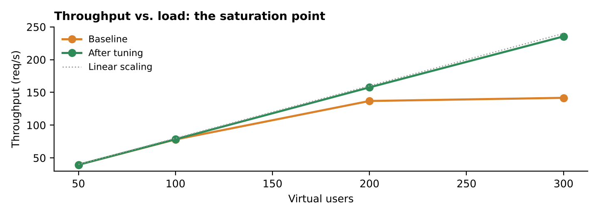
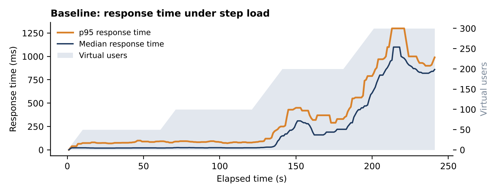

# Performance Testing Portfolio: ShopLite API load test

A complete performance testing engagement on a demo e-commerce API: workload model, step load test, bottleneck analysis, fix, and verification under identical load.

**[Read the full report (PDF)](report/Performance-Test-Report-ShopLite.pdf)**

## Results at a glance

| Virtual users | Baseline throughput | Baseline p95 | After tuning throughput | After tuning p95 |
|---|---|---|---|---|
| 50 | 39.7 req/s | 83 ms | 39.4 req/s | 42 ms |
| 100 | 78.5 req/s | 82 ms | 79.3 req/s | 40 ms |
| 200 | 138.1 req/s | 355 ms | 158.2 req/s | 39 ms |
| 300 | 141.2 req/s | **1,000 ms** | 235.8 req/s | **37 ms** |

- **Bottleneck found:** the database connection pool (3 connections) saturated at about 140 req/s, so extra users only added waiting time.
- **After tuning** (larger pool, caching, faster checkout query, indexed search): +67% throughput and p95 down 96% at 300 users, with 0 errors.




## What's in this repository

| Folder | Contents |
|---|---|
| `app/` | The system under test: ShopLite demo API (Python / FastAPI) |
| `jmeter/` | JMeter test plan (`.jmx`) with weighted workload, think time and assertions, plus a script that runs each load step and builds the HTML dashboard |
| `load/` | The same scenario as a Locust script, used for the recorded runs |
| `results/` | Raw CSV results for both runs |
| `report/` | PDF report, charts and the script that builds them |

## Run it yourself

```bash
pip install fastapi uvicorn locust
uvicorn --app-dir app shop:app --port 8000            # baseline
TUNED=1 uvicorn --app-dir app shop:app --port 8000    # after tuning

# JMeter (non-GUI), one run per load step, HTML dashboard for each
cd jmeter && ./run-steps.sh 127.0.0.1 8000

# or Locust, full step profile in one run
locust -f load/locustfile.py --headless -H http://127.0.0.1:8000 --csv results/run
```

## About me

Michael Youssef, Section Head of IT Systems & Testing Automation at Telecom Egypt. 9+ years in QA and 15+ years in telecom IT. I built Telecom Egypt's performance testing practice with Apache JMeter. ISTQB CTFL certified.

I help teams find out whether their website, app or API will hold up under real traffic before launch.

*The system under test is a demo built for this portfolio. All figures come from real test runs in a lab environment.*
